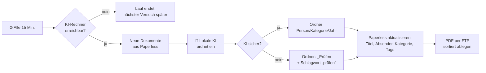

# 📬 Briefe automatisch ablegen – n8n + lokale KI

Ein n8n-Workflow, der gescannte Briefe und E-Mail-Belege **automatisch einordnet, benennt und sortiert ablegt**. Die Texterkennung übernimmt eine **lokale KI**, die auf dem eigenen Rechner läuft. Kein Dokument verlässt das Heimnetz.

> Läuft bei mir im Alltag: Alle 15 Minuten kommen neue Dokumente aus Paperless dazu und landen fertig sortiert in der Dateiablage.

## Das Problem

Post und Rechnungen kommen ungeordnet an. Von Hand müsste man bei jedem Dokument herausfinden, von wem es ist, worum es geht und wohin es gehört, es dann umbenennen und richtig ablegen. Das kostet Zeit und wird schnell liegen gelassen.

## Die Lösung

**Ergebnis je Dokument:**
`Dokumente/<Person>/<Kategorie>/<Jahr>/<Datum>_<Absender>_<Titel>_<Nr>.pdf`
also zum Beispiel `Dokumente/Max/Versicherungen/2026/2026-03-14_Musterversicherung_Beitragsanpassung Kfz_412.pdf`

## Was den Workflow ausmacht

- **Datenschutz durch lokale KI:** Ollama mit `qwen2.5:14b` läuft auf dem eigenen PC. Persönliche Dokumente gehen an keinen Cloud-Dienst.
- **Feste Antwortstruktur:** Die KI muss in einem vorgegebenen JSON-Schema antworten (Person, Kategorie, Absender, Datum, Titel, sicher). Die Kategorien sind als feste Liste vorgegeben, damit die KI keine eigenen erfindet.
- **Ein Mensch prüft im Zweifel:** Ist sich die KI unsicher oder erkennt keinen Absender, landet das Dokument in einem Prüfordner, statt falsch abgelegt zu werden.
- **Robust im Alltag:**
  - Ist der KI-Rechner aus, endet der Lauf sauber ohne Fehlermeldung.
  - Bei kurzen Ausfällen von Paperless gibt es drei Wiederholversuche.
  - Eine Markierung („abgelegt“) verhindert doppelte Verarbeitung.
  - Die Dokumentnummer im Dateinamen verhindert Namenskonflikte.
- **Wartungsfreundlich:**
  - Alle änderbaren Werte stehen in einem einzigen Knoten „Einstellungen“.
  - Jeder Knoten hat einen sprechenden deutschen Namen und eine Notiz.
  - Die Abschnitte sind farbig gruppiert.
  - Es gibt keine Code-Knoten.

## Eingesetzte Technik

| Baustein | Aufgabe |
| --- | --- |
| [n8n](https://n8n.io) (self-hosted, Docker) | Ablaufsteuerung |
| [Paperless-ngx](https://docs.paperless-ngx.com) | Dokumentenverwaltung mit Texterkennung (OCR) |
| [Ollama](https://ollama.com) + qwen2.5:14b | Lokale KI zur Einordnung |
| FTP (z. B. FRITZ!Box-Speicher) | Sortierte PDF-Ablage |

## Selbst nutzen

1. In n8n über **Import from File** die Datei [`briefe-automatisch-ablegen.json`](briefe-automatisch-ablegen.json) importieren.
2. Zwei Zugangsdaten anlegen und den Knoten zuweisen:
   - **Header Auth** für Paperless: Name `Authorization`, Wert `Token <dein-paperless-token>`
   - **FTP** für den Ablagespeicher
3. In Paperless das Schlagwort **abgelegt** anlegen.
4. Im Knoten **Einstellungen** die Adressen von Paperless und Ollama, das Modell, den Ablageordner und bei Bedarf die Personen und Kategorien in der KI-Anweisung anpassen.
5. Erst mit einzelnen Dokumenten testen, dann aktivieren.

> Alle Namen, Adressen und IDs in der Datei sind Platzhalter (Max/Erika Mustermann, 192.0.2.x). Zugangsdaten sind nicht enthalten.

## Über mich

Ich komme aus der industriellen Automatisierungstechnik und baue heute Prozessautomatisierungen mit KI. Mehr auf meinem [GitHub-Profil](https://github.com/Matthias-Ziw).
